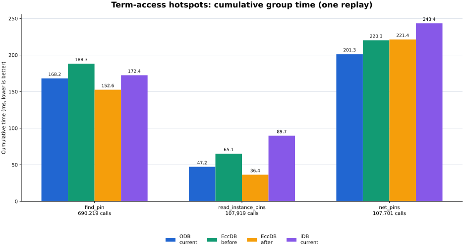

# 以 ODB 为基准：EccDB、iDB 完整加速比与本轮优化效果

日期：2026-09-30。数据采用 Term 访问优化后的最新一次 ISPD18 test6 v3 trace 回放；本文件只整理已有实测结果，没有新增布线或回放实验。

## 本轮效果

EccDB 全部 34 组累计耗时从 **4417.523 ms 降到 3487.538 ms**，本轮观测下降 **21.05%**。按名查 InstanceTerm 下降 **18.92%**，Instance Term 列表读取下降 **44.12%**；Net-Pin 遍历约为 221 ms，本轮没有改善。

统一以本轮 ODB 为 **1× 基准**：EccDB 的按名查 InstanceTerm、Instance Term 列表读取分别为 **1.102×、1.297×**；iDB 对应为 **0.975×、0.526×**。Net-Pin 遍历为 EccDB **0.909×**、iDB **0.827×**，两者均慢于本轮 ODB。

本轮同时改变了热点访问路径和 Release 断言配置。下列降幅是这些修改的联合观测结果，不能把全部变化归因于去掉显式校验；Wire、Guide 等接口也受到重新编译的影响。

## 加速比定义与计时口径

- **ODB 固定为 1× 基准**。
- EccDB 加速比 = **ODB 时间 / EccDB 优化后时间**。
- iDB 加速比 = **ODB 时间 / iDB 时间**。
- 大于 1 表示该数据库比 ODB 快，小于 1 表示比 ODB 慢。两列使用同一个 ODB 分子，不能把 iDB 列理解成 iDB/EccDB。EccDB 加速比与旧报告的“EccDB/ODB 耗时比”互为倒数。
- EccDB 降幅 = **(优化前 EccDB 时间 − 优化后 EccDB 时间) / 优化前 EccDB 时间**；负值表示本轮耗时增加。
- 所有 ms 都是一组操作的累计时间，不是单次 API 延迟。加速比按未四舍五入的原始 ns 计算；总加速比由累计时间相除，不平均各行比值。
- 计时包含每条 trace 的 adaptor 调用与返回字段构造；排除 LEF/DEF/Guide/JSONL parser、初始建库、binding、规范化和正确性校验。
- 每条事件使用一对 `steady_clock::now()`，随后按 API 类别累计；`backend.supports(event)` 的能力检查也在计时外。历史 raw JSON 中“one timer pair per recorded group”是措辞问题，本次代码检查已修正元数据；原始数字保留。
- `—` 表示 iDB 不支持，不能计算对应加速比；`<0.001` 表示非零但小于 0.001 ms。调用仅一次的极小耗时项只保留记录，不据其比值判断稳定性能。

## 总体对比

| 比较范围 | ODB ms | iDB ms | EccDB 前 ms | EccDB 后 ms | EccDB 降幅 | EccDB 加速比（ODB/EccDB） | iDB 加速比（ODB/iDB） |
| --- | ---: | ---: | ---: | ---: | ---: | ---: | ---: |
| ODB/EccDB 完整 34 组 | 5400.417 | 不适用：缺 16 组 | 4417.523 | 3487.538 | 21.05% | 1.548× | — |
| 三端共同 18 组 | 1259.628 | 1430.554 | 1937.960 | 1547.323 | 20.16% | 0.814× | 0.881× |

共同 18 组中，EccDB 本轮总耗时仍比 ODB 高 **22.84%**，iDB 比 ODB 高 **13.57%**。完整 34 组中，EccDB 的优势主要来自 Instance Pin Access 写入；不能拿 iDB 的 18 组总计与另两端的 34 组总计直接比较。

总体加速比的前后变化如下。每个比值使用各自那轮的 ODB 时间除以同一轮对应数据库时间，不混用前后两轮。

| 加速比口径 | 优化前 | 本轮优化后 |
| --- | ---: | ---: |
| 完整 34 组：ODB / EccDB | 1.215× | 1.548× |
| 共同 18 组：ODB / EccDB | 0.655× | 0.814× |
| 共同 18 组：ODB / iDB | 0.858× | 0.881× |

同期 ODB 全量累计变化约 +0.60%，iDB 共同项累计变化约 −3.24%；单轮仍存在环境波动，不将这些比值变化解释为某一处代码改动的独立因果。

## 完整 34 项：前后效果与统一 ODB 基准加速比

| API 操作 | 次数 | EccDB 前 ms | EccDB 后 ms | EccDB 降幅 | ODB ms | EccDB 加速比（ODB/EccDB） | iDB ms | iDB 加速比（ODB/iDB） |
| --- | ---: | ---: | ---: | ---: | ---: | ---: | ---: | ---: |
| 按名查 Instance `find_instance` | 107,919 | 54.083 | 49.488 | 8.50% | 111.762 | 2.258× | 87.619 | 1.276× |
| 按名查 InstanceTerm `find_pin` | 690,219 | 188.274 | 152.648 | 18.92% | 168.163 | 1.102× | 172.395 | 0.975× |
| 读取 Instance `read_instance` | 107,919 | 31.417 | 27.578 | 12.22% | 24.891 | 0.903× | 41.525 | 0.599× |
| 读取 Instance Term 列表 `read_instance_pins` | 107,919 | 65.129 | 36.396 | 44.12% | 47.216 | 1.297× | 89.746 | 0.526× |
| 遍历 Net-Pin `net_pins` | 107,701 | 220.261 | 221.362 | -0.50% | 201.317 | 0.909× | 243.450 | 0.827× |
| 读取 Net 属性 `read_net_attributes` | 107,701 | 70.021 | 62.628 | 10.56% | 90.735 | 1.449× | — | — |
| 扫描 Instance `scan_instances` | 1 | 5.280 | 3.857 | 26.97% | 4.508 | 1.169× | 8.792 | 0.513× |
| 扫描 Net `scan_nets` | 3 | 7.154 | 7.168 | -0.20% | 15.147 | 2.113× | 24.191 | 0.626× |
| 读取 Wire `read_wire` | 107,701 | 24.747 | 19.569 | 20.92% | 14.831 | 0.758× | 17.055 | 0.870× |
| 替换 Wire `replace_wire` | 107,589 | 1340.155 | 1027.890 | 23.30% | 667.519 | 0.649× | 744.512 | 0.897× |
| 读取 Guide `read_guides` | 107,701 | 375.706 | 275.089 | 26.78% | 345.748 | 1.257× | — | — |
| 替换 Guide `replace_guides` | 107,701 | 639.495 | 479.654 | 24.99% | 555.792 | 1.159× | — | — |
| 追加 Track Assignment `append_track_assignment` | 107,589 | 404.574 | 327.872 | 18.96% | 407.776 | 1.244× | — | — |
| 替换 Instance Pin Access `replace_instance_pin_access` | 107,919 | 872.555 | 702.820 | 19.45% | 2661.416 | 3.787× | — | — |
| 替换 Master Pin Access `replace_master_pin_access` | 117 | 112.937 | 88.291 | 21.82% | 74.437 | 0.843× | — | — |
| 追加 BTerm Pin Access `append_bterm_pin_access` | 1,211 | 1.720 | 1.447 | 15.85% | 2.054 | 1.419× | — | — |
| 读取 BTerm Pin Access `read_bterm_pin_access` | 1,211 | 0.195 | 0.152 | 22.03% | 0.320 | 2.100× | — | — |
| 读取 BlockTerm `read_bterms` | 1 | 1.306 | 1.241 | 4.99% | 4.130 | 3.329× | 1.149 | 3.595× |
| 读取 Library Master `read_library_masters` | 1 | 0.073 | 0.072 | 1.11% | 0.080 | 1.118× | 0.074 | 1.086× |
| 读取 MasterTerm `read_library_terms` | 1 | 0.493 | 0.476 | 3.38% | 0.571 | 1.199× | — | — |
| 读取 MasterPin 几何 `read_library_mpin_geometry` | 1 | 1.767 | 1.694 | 4.11% | 1.849 | 1.092× | — | — |
| 读取 Library 障碍 `read_library_obstructions` | 1 | 0.040 | 0.036 | 9.72% | 0.043 | 1.193× | — | — |
| 读取 Tech 基本信息 `read_tech_header` | 1 | 0.005 | 0.003 | 36.97% | 0.003 | 0.947× | — | — |
| 读取 Tech Layer `read_tech_layers` | 1 | 0.042 | 0.020 | 52.43% | 0.019 | 0.929× | 0.016 | 1.161× |
| 读取 Tech Via `read_tech_vias` | 1 | 0.030 | 0.028 | 8.63% | 0.034 | 1.215× | 0.025 | 1.338× |
| 读取 Routing Layer 规则 `read_routing_layer_rules` | 1 | 0.033 | 0.029 | 13.24% | 0.032 | 1.108× | — | — |
| 读取 Cut Layer 规则 `read_cut_layer_rules` | 1 | 0.012 | 0.010 | 12.67% | 0.008 | 0.795× | — | — |
| 读取 Via Generate 规则 `read_via_generate_rules` | 1 | 0.005 | 0.009 | -69.24% | 0.001 | 0.135× | — | — |
| 读取 NDR `read_ndrs` | 1 | 0.003 | 0.002 | 27.97% | 0.003 | 1.375× | — | — |
| 读取 Design Via `read_design_vias` | 1 | <0.001 | <0.001 | 10.26% | <0.001 | 2.457× | <0.001 | 2.688× |
| 读取 Blockage `read_blockages` | 1 | <0.001 | <0.001 | 34.92% | 0.003 | 6.829× | <0.001 | 6.829× |
| 读取 Die `read_die` | 1 | 0.004 | 0.002 | 61.73% | <0.001 | 0.626× | <0.001 | 3.129× |
| 读取 GCell Grid `read_gcell_grid` | 1 | 0.002 | 0.001 | 13.16% | 0.002 | 1.235× | 0.001 | 1.336× |
| 扫描 Track `scan_tracks` | 1 | 0.003 | 0.003 | -4.89% | 0.005 | 1.458× | 0.003 | 1.462× |

其中 `scan_instances` 仅记录一次批量扫描、`scan_nets` 记录三次批量扫描；它们不是只扫描一个 Instance/Net。Library/Tech 的单次记录也可能内部遍历多个对象。

## 三项直接修改的热点



| 操作 | 本轮主要改动 | 观测结果 |
| --- | --- | --- |
| 按名查 InstanceTerm | 由名称索引取得有效 Term ID 后直接取 component；名称使用已有 `master_term_ptr` | 188.274 → 152.648 ms；快于本轮 ODB、iDB |
| 读取 Instance Term 列表 | 每项直接取 Term 并读取已有 MasterTerm 缓存；取消逐项再按 Library ID 查库 | 65.129 → 36.396 ms；快于本轮 ODB、iDB |
| 遍历 Net-Pin | 每个 Net 先取得一次 typed Term storage；受维护的关系 ID 直接 get | 220.261 → 221.362 ms；本轮没有改善 |

## 改动范围与当前诊断

| 文件（相对 ecc-tools 仓库） | 本轮改动 |
| --- | --- |
| `CMakeLists.txt:35` | Release flags 补齐 `-DNDEBUG`，实际命令为 `-O3 -DNDEBUG`；Debug flags 未改。 |
| `src/database/eccdb/storage/design/netlist/storage/DesignNetlistStorage.h:70` | canonical `instanceTerm(id)` 要求 live ID，直接 `registry.get`；旧 `instancePin(id)` 仍保留非法 ID 检查。 |
| `src/database/eccdb/service/query/PhysicalDesignService.cpp:513` | `forEachNetPin` 每个 Net 只取得一次 typed storage，避免逐 Term 的 `valid/all_of` 与重复 pool 查找。 |
| `src/database/eccdb/benchmarks/DrtTraceEccdbIdb.cpp:2794,2889` | 两个名称读取使用已有 `master_term_ptr`，取消再次跨 Library registry 查询和检查。 |

InstanceTerm 仍是独立 EnTT entity；没有新增 Instance/Net → Term* 指针表，也没有修改 snapshot schema、Wire 存储或 trace 计时边界。这轮取消的是热点读取的重复检查与 Release 下的断言，不是删除数据库所有验证逻辑。

Net-Pin 的差距没有因本轮改动消失。该项仍包含关系遍历、component 稀疏映射、visitor 回调及 JSON 字段构造；现有单轮结果不能分离这些成本，不能据此断言剩余差距就是 EnTT 的固有开销。

Wire 写回为 ODB **667.519 ms**、EccDB **1027.890 ms**、iDB **744.512 ms**；相对 ODB 加速比分别为 EccDB **0.649×**、iDB **0.897×**。EccDB 比 ODB 慢约 **54.0%**，仍是共同项的主要差距。它本轮也下降了 23.30%，但没有修改 Wire 数据结构，不能算成 Term 直接优化收益。

## 实验结构与正确性

| 项目 | 本轮配置或结果 |
| --- | --- |
| 数据集 | 原始 ISPD2018 `ispd18_test6.input.lef/.def/.guide` |
| 初始规模 | 107,919 Instances；107,701 普通 Nets |
| 操作来源 | ODB 后端的真实 TritonRoute 导入/写回操作记录；复用已有 v3 JSONL |
| 回放方式 | ODB、EccDB、iDB 各一个进程、各一轮，并行固定 CPU 24/25/26 |
| 内存限制 | shell `ulimit -v 524288000`，每个进程地址空间上限 500 GiB |
| Trace 覆盖 | 40 组声明；实际 34 组、1,878,138 条事件；三端共同 18 组、1,336,980 条事件 |
| 当前模型 | 独立 InstanceTerm / BlockTerm / BlockPin entity；已有 runtime MasterTerm/Instance 指针缓存保留 |
| 编译 | EccDB/iDB 重编译为 `-O3 -DNDEBUG`；ODB 复用原 native 可执行文件，也带 `-O3 -DNDEBUG` |
| 编译差异 | 两侧 LTO、`_GLIBCXX_ASSERTIONS` 等配置仍有差别；本轮只对齐 NDEBUG，不声称所有 flags 相同 |
| 现有测试 | 73 Design 测试通过（1 个原有 disabled）；trace schema/canonical geometry 测试通过 |
| EccDB / ODB 事件验证 | 各 1,878,138 / 1,878,138，全量通过 |
| iDB 事件验证 | 1,336,980 个支持事件全部通过；541,158 个事件明确 unsupported |
| 最终状态 | 107,701 个 Net-Pin 检查；107,701 个 Wire 检查；107,589 条写回 Wire；2,957,852 个 primitives；未验证 Wire 为 0 |
| 扩展字段 | ODB/EccDB 校验 1,099 个 endpoint-extension 字段；iDB 只验证共同几何与连接 |

这次是同一实际操作序列的数据库 API 回放，不是三后端各自重新跑完详细布线，也不提供 router 算法耗时或本轮 RSS 比较。每端只有一轮，所以降幅和加速比属于此次观测。

## 六项未触发的操作

| API | 次数 | 本轮耗时 / 加速比 |
| --- | ---: | --- |
| `append_bterm_stack_wire` | 0 | 未测 |
| `clear_wire` | 0 | 未测 |
| `define_design_via` | 0 | 未测 |
| `read_master_pin_access` | 0 | 未测 |
| `read_preferred_pin_access` | 0 | 未测 |
| `read_special_wire` | 0 | 未测 |

上述未触发项不算“通过非空功能测试”。该设计的 SpecialNet、NDR、via-generate rule 数量为 0，相应读取不能证明非空规则的完整覆盖。

## 数据来源与复现

Trace SHA-256：`0cfd87eb11d2a08cfc05d4fdd901b9659885319aea5bd099f27ffdb2c59887b8`。本轮与优化前使用同一 trace 和 LEF/DEF/Guide；全部比值来自原始 ns。

- [本轮原始结果 JSON](/home/zhuxu1/workspace/daily/2026年9月30日/term-access-optimization/results/optimized.json)
- [本轮原始结果 JSON（仓库内副本）](optimized.json)
- [优化前原始结果 JSON](/home/zhuxu1/workspace/daily/2026年9月30日/term-access-optimization/results/before.json)
- [实际编译命令：优化前](/home/zhuxu1/workspace/daily/2026年9月30日/term-access-optimization/code/compile-commands-before.json) / [优化后](/home/zhuxu1/workspace/daily/2026年9月30日/term-access-optimization/code/compile-commands-after.json)
- [完整实验与代码归档](/home/zhuxu1/workspace/daily/2026年9月30日/term-access-optimization/README.md)

在工作仓库 `/home/zhuxu1/workspace/ecc-tools` 中重现本次回放的命令如下；本文件整理阶段没有再次执行它：

```bash
ulimit -v 524288000
python3 src/database/eccdb/benchmarks/DrtTraceComparison.py \
  --trace build/term-pin-v3-20260930.trace.jsonl \
  --lef /home/zhuxu1/workspace/reference/ispd2018/ispd18_test6/ispd18_test6.input.lef \
  --def /home/zhuxu1/workspace/reference/ispd2018/ispd18_test6/ispd18_test6.input.def \
  --guides /home/zhuxu1/workspace/reference/ispd2018/ispd18_test6/ispd18_test6.input.guide \
  --odb build/openroad-native-eccdb-build/src/drt/eccdbDrtTraceOdb \
  --eccdb-idb bin/eccdb_drt_trace_replay \
  --repeat 1 --parallel --cpu 24 \
  --output build/term-pin-access-optimized-20260930.json
```
