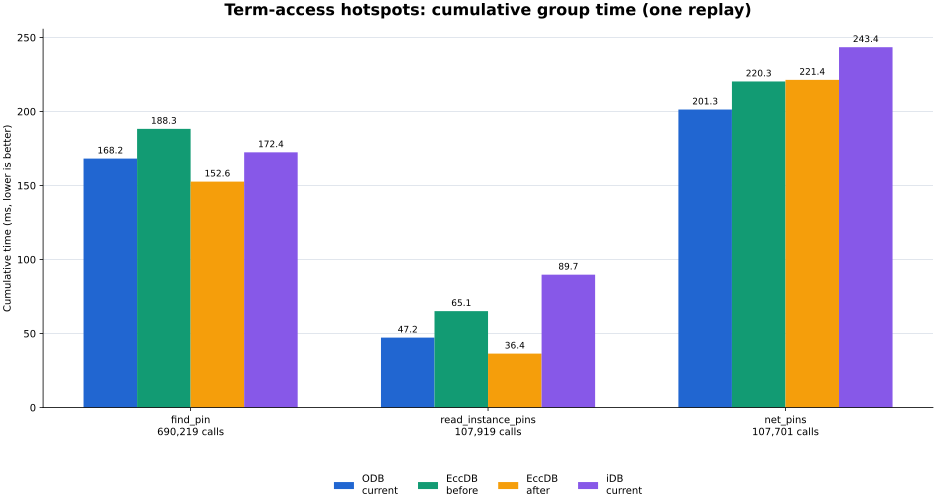

# Term 访问路径优化：v3 trace 三端回放

本报告只比较 2026-09-30 的独立 Term/Pin entity 基线与本次候选实现。每端只运行一轮，以下均是一次观测，不能称为稳定的性能提升。

## 实验范围

- 同一 ISPD18 test6 v3 trace：`1,878,138` 条事件、`34` 组已出现 API；三端共同支持 `18` 组。
- 计时包围单条记录的 adapter 调用和返回字段构造；不含 LEF/DEF/Guide/JSONL parser、初始建库、binding/canonicalization、逐事件和最终正确性校验。
- 候选同时改变了三条 Term 访问路径，并切换到 Release/`NDEBUG`；iDB 也在相同 Release 配置下重建。因此不能将时间差拆分归因到某一处访问优化、断言移除、编译配置或单轮波动。
- `EccDB/ODB` 是时间比，小于 `1.0x` 表示 EccDB 更快；`ODB/EccDB` 是其倒数。

## 汇总

| 范围 | 事件/组 | ODB 当前 ms | EccDB 优化前 ms | EccDB 优化后 ms | EccDB 降幅 | EccDB/ODB | ODB/EccDB | iDB 当前 ms |
| --- | ---: | ---: | ---: | ---: | ---: | ---: | ---: | ---: |
| EccDB 全部 34 组 | 1,878,138/34 | 5400.417 | 4417.523 | 3487.538 | +21.05% | 0.646x | 1.548x | 不可比 |
| 三端共同 18 组 | 1,336,980/18 | 1259.628 | 1937.960 | 1547.323 | +20.16% | 1.228x | 0.814x | 1430.554 |

iDB 不支持 16 个已记录组，不能将 iDB 的 18 组总计同 ODB/EccDB 的 34 组总计横向比较。

## 三个 Term 热点

| API | 次数 | ODB 当前 ms | EccDB 前 ms | EccDB 后 ms | EccDB 降幅 | EccDB/ODB | iDB 当前 ms |
| --- | ---: | ---: | ---: | ---: | ---: | ---: | ---: |
| `find_pin` | 690,219 | 168.163 | 188.274 | 152.648 | +18.92% | 0.908x | 172.395 |
| `read_instance_pins` | 107,919 | 47.216 | 65.129 | 36.396 | +44.12% | 0.771x | 89.746 |
| `net_pins` | 107,701 | 201.317 | 220.261 | 221.362 | -0.50% | 1.100x | 243.450 |



`find_pin` 和 `read_instance_pins` 分别观察到 18.92% 和 44.12% 的 EccDB 累计时间下降。`net_pins` 为 220.261 ms → 221.362 ms，单轮内没有改善；它仍包含 Net endpoint 列表遍历、visitor/std::function 调用和 JSON 字段投影，本次减少的 Term 解析/校验不是唯一成本。0.50% 的单轮差异不构成退化结论。

## 完整 34 组累计时间

`-` 表示 iDB 不支持。所有 ms 是一整组累计时间，不是单次 API 延迟；`<0.001` 表示非零但小于 0.001 ms。仅调用一次且极小的组保留原始记录，但不据其比值判断稳定性能。

| API group | 次数 | ODB 当前 ms | EccDB 前 ms | EccDB 后 ms | EccDB 降幅 | EccDB/ODB | iDB 当前 ms |
| --- | ---: | ---: | ---: | ---: | ---: | ---: | ---: |
| `append_bterm_pin_access` | 1,211 | 2.054 | 1.720 | 1.447 | +15.85% | 0.705x | - |
| `append_track_assignment` | 107,589 | 407.776 | 404.574 | 327.872 | +18.96% | 0.804x | - |
| `find_instance` | 107,919 | 111.762 | 54.083 | 49.488 | +8.50% | 0.443x | 87.619 |
| `find_pin` | 690,219 | 168.163 | 188.274 | 152.648 | +18.92% | 0.908x | 172.395 |
| `net_pins` | 107,701 | 201.317 | 220.261 | 221.362 | -0.50% | 1.100x | 243.450 |
| `read_blockages` | 1 | 0.003 | <0.001 | <0.001 | +34.92% | 0.146x | <0.001 |
| `read_bterm_pin_access` | 1,211 | 0.320 | 0.195 | 0.152 | +22.03% | 0.476x | - |
| `read_bterms` | 1 | 4.130 | 1.306 | 1.241 | +4.99% | 0.300x | 1.149 |
| `read_cut_layer_rules` | 1 | 0.008 | 0.012 | 0.010 | +12.67% | 1.258x | - |
| `read_design_vias` | 1 | <0.001 | <0.001 | <0.001 | +10.26% | 0.407x | <0.001 |
| `read_die` | 1 | <0.001 | 0.004 | 0.002 | +61.73% | 1.598x | <0.001 |
| `read_gcell_grid` | 1 | 0.002 | 0.002 | 0.001 | +13.16% | 0.810x | 0.001 |
| `read_guides` | 107,701 | 345.748 | 375.706 | 275.089 | +26.78% | 0.796x | - |
| `read_instance` | 107,919 | 24.891 | 31.417 | 27.578 | +12.22% | 1.108x | 41.525 |
| `read_instance_pins` | 107,919 | 47.216 | 65.129 | 36.396 | +44.12% | 0.771x | 89.746 |
| `read_library_masters` | 1 | 0.080 | 0.073 | 0.072 | +1.11% | 0.895x | 0.074 |
| `read_library_mpin_geometry` | 1 | 1.849 | 1.767 | 1.694 | +4.11% | 0.916x | - |
| `read_library_obstructions` | 1 | 0.043 | 0.040 | 0.036 | +9.72% | 0.838x | - |
| `read_library_terms` | 1 | 0.571 | 0.493 | 0.476 | +3.38% | 0.834x | - |
| `read_ndrs` | 1 | 0.003 | 0.003 | 0.002 | +27.97% | 0.727x | - |
| `read_net_attributes` | 107,701 | 90.735 | 70.021 | 62.628 | +10.56% | 0.690x | - |
| `read_routing_layer_rules` | 1 | 0.032 | 0.033 | 0.029 | +13.24% | 0.902x | - |
| `read_tech_header` | 1 | 0.003 | 0.005 | 0.003 | +36.97% | 1.056x | - |
| `read_tech_layers` | 1 | 0.019 | 0.042 | 0.020 | +52.43% | 1.077x | 0.016 |
| `read_tech_vias` | 1 | 0.034 | 0.030 | 0.028 | +8.63% | 0.823x | 0.025 |
| `read_via_generate_rules` | 1 | 0.001 | 0.005 | 0.009 | -69.24% | 7.411x | - |
| `read_wire` | 107,701 | 14.831 | 24.747 | 19.569 | +20.92% | 1.320x | 17.055 |
| `replace_guides` | 107,701 | 555.792 | 639.495 | 479.654 | +24.99% | 0.863x | - |
| `replace_instance_pin_access` | 107,919 | 2661.416 | 872.555 | 702.820 | +19.45% | 0.264x | - |
| `replace_master_pin_access` | 117 | 74.437 | 112.937 | 88.291 | +21.82% | 1.186x | - |
| `replace_wire` | 107,589 | 667.519 | 1340.155 | 1027.890 | +23.30% | 1.540x | 744.512 |
| `scan_instances` | 1 | 4.508 | 5.280 | 3.857 | +26.97% | 0.856x | 8.792 |
| `scan_nets` | 3 | 15.147 | 7.154 | 7.168 | -0.20% | 0.473x | 24.191 |
| `scan_tracks` | 1 | 0.005 | 0.003 | 0.003 | -4.89% | 0.686x | 0.003 |

## 正确性与输入一致性

| 字段 | 优化前 | 优化后 | 一致 |
| --- | --- | --- | ---: |
| `trace.sha256` | `0cfd87eb11d2a08cfc05d4fdd901b9659885319aea5bd099f27ffdb2c59887b8` | `0cfd87eb11d2a08cfc05d4fdd901b9659885319aea5bd099f27ffdb2c59887b8` | 是 |
| `lef.sha256` | `7660a3586715137f5acc10fdbe83e12f3e2e52d8d6d4f7e7ef88b899bec5f03a` | `7660a3586715137f5acc10fdbe83e12f3e2e52d8d6d4f7e7ef88b899bec5f03a` | 是 |
| `def.sha256` | `d9a161aaf8a3a9d7bce321ff3dec2c92aead0cacc358100cb61a9cccc101624b` | `d9a161aaf8a3a9d7bce321ff3dec2c92aead0cacc358100cb61a9cccc101624b` | 是 |
| `guides.sha256` | `1390e4fcb03c387ac008184eac5545cc07df37d22d0dc14ffbe65f68158647bd` | `1390e4fcb03c387ac008184eac5545cc07df37d22d0dc14ffbe65f68158647bd` | 是 |
| `events` | `1878138` | `1878138` | 是 |
| `observed_group_count` | `34` | `34` | 是 |
| `common_group_count` | `18` | `18` | 是 |

优化后回放的验证字段：

- `odb`：验证事件 1,878,138/1,878,138；all_supported_events=True；final_route_state_comparable=True；net_check=107,701，wire_check=107,701，final_wires=107,589，primitive=2,957,852，unvalidated_wire=0
- `eccdb`：验证事件 1,878,138/1,878,138；all_supported_events=True；final_route_state_comparable=True；net_check=107,701，wire_check=107,701，final_wires=107,589，primitive=2,957,852，unvalidated_wire=0
- `idb`：验证事件 1,336,980/1,878,138；all_supported_events=True；final_route_state_comparable=True；net_check=107,701，wire_check=107,701，final_wires=107,589，primitive=2,957,852，unvalidated_wire=0

iDB 因 unsupported 组报告 `all_events=false`，适用条件是 `all_supported_events=true`。ODB/EccDB 完整执行并验证全部事件。trace schema 没有单独的输出 checksum 字段，因此此处以相同 trace/LEF/DEF/Guide SHA-256、事件数和最终 route-state 验证字段为正确性依据。

## 本轮代码改动

- `CMakeLists.txt:35`：Release C++ flags 增加 `-DNDEBUG`。
- `src/database/eccdb/storage/design/netlist/storage/DesignNetlistStorage.h:70`：`instanceTerm()` 内联直接 `registry.get`，用于已维护关系中的 Term ID。
- `src/database/eccdb/service/query/PhysicalDesignService.cpp:513`：`forEachNetPin()` 只解析一次 `DesignInstanceTerm` typed storage，再直接取得 Term component。
- `src/database/eccdb/benchmarks/DrtTraceEccdbIdb.cpp:2794,2889`：`read_instance_pins` 与 `find_pin` 读取已缓存的 `master_term_ptr->name`，不再按 MasterTerm ID 跨 registry 重新查找。

构建和测试：

```bash
cmake --build build/adapter-differential \
  --target eccdb_drt_trace_replay eccdb_design_test eccdb_drt_trace_test \
  --parallel 64
bin/eccdb_design_test       # 73 tests passed
bin/eccdb_drt_trace_test   # trace schema/canonical geometry tests passed
```

构建日志：`build/term-pin-access-optimized-20260930-build.log`；Design 测试：`build/term-pin-access-optimized-20260930-design-tests.log`；trace 测试：`build/term-pin-access-optimized-20260930-trace-tests.log`。

## 回放与再生成

实际三端回放：

```bash
python3 src/database/eccdb/benchmarks/DrtTraceComparison.py \
  --trace build/term-pin-v3-20260930.trace.jsonl \
  --lef /home/zhuxu1/workspace/reference/ispd2018/ispd18_test6/ispd18_test6.input.lef \
  --def /home/zhuxu1/workspace/reference/ispd2018/ispd18_test6/ispd18_test6.input.def \
  --guides /home/zhuxu1/workspace/reference/ispd2018/ispd18_test6/ispd18_test6.input.guide \
  --odb build/openroad-native-eccdb-build/src/drt/eccdbDrtTraceOdb \
  --eccdb-idb bin/eccdb_drt_trace_replay \
  --repeat 1 --parallel --cpu 24 \
  --output build/term-pin-access-optimized-20260930.json
```

候选 EccDB 子进程实际命令：

```bash
taskset -c 25 /home/zhuxu1/workspace/ecc-tools/bin/eccdb_drt_trace_replay --backend eccdb --trace /home/zhuxu1/workspace/ecc-tools/build/term-pin-v3-20260930.trace.jsonl --lef /home/zhuxu1/workspace/reference/ispd2018/ispd18_test6/ispd18_test6.input.lef --def /home/zhuxu1/workspace/reference/ispd2018/ispd18_test6/ispd18_test6.input.def --output /home/zhuxu1/workspace/ecc-tools/build/term-pin-access-optimized-20260930.runs/eccdb-1.json --guides /home/zhuxu1/workspace/reference/ispd2018/ispd18_test6/ispd18_test6.input.guide
```

可用任意显式 JSON 路径重新生成本报告：

```bash
/home/zhuxu1/.venv/bin/python \
  src/database/eccdb/doc/results/Term_Access_Optimization_20260930/analysis.py \
  --before src/database/eccdb/doc/results/Term_Pin_Entity_V3_Trace_Replay_20260930.json \
  --after build/term-pin-access-optimized-20260930.json \
  --output-dir src/database/eccdb/doc/results/Term_Access_Optimization_20260930
```

## 产物

- `all_operations.csv`：完整 34 组机器可读表。
- `term_access_hotspots.svg` / `.png`：一张白底热点图。
- `analysis.py`：接受显式 `--before` / `--after` JSON 路径的生成器。
