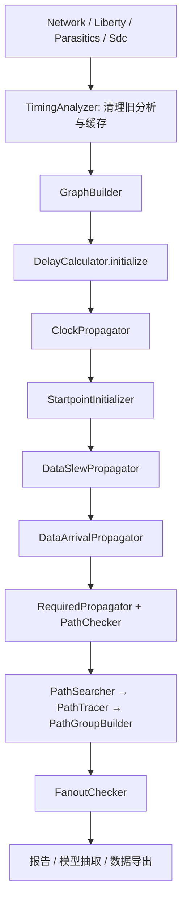

# iSTA 功能模块

目录对应一组可解释的功能，类对应其中的计算职责。Calculator 求局部数值，Propagator 沿依赖传播状态，Checker 评价约束，Writer 输出特定结果。类可以短小；不为每个类再建目录或静态库。

目录、文件和构建目标采用不同粒度：目录让读者找到一项功能，文件容纳可独立理解的算法，构建目标表达实际可消费的组件。一个算法有独立文件，并不意味着它需要独立目录或库。当前划分依据这些职责，不能据此声称它是唯一最优架构。

```text
module/
├── TimingAnalyzer.cpp/.hpp     一次完整分析的清理和步骤顺序
├── reader/             IDB/层次 Verilog/Liberty/SPEF 转为内部数据
├── writer/             各格式的值选取、表示和写出
│   └── sdc/ sdf/ liberty/     独立合同，按需链接
├── sdc/                       Tcl 命令、对象查询、SDC 文件接口
│   ├── SdcCommand / SdcReader / SdcTclCmd / WriteSdc
│   └── query/ clock/ environment/ exception/ design/
├── graph_builder/             连接建图、方向解析、逻辑求值、端点分类和排序
├── delay_calculator/           局部 delay、slew 和 check table 求值
│   ├── DelayCalculator / DelayResult / ThresholdNormalizer
│   ├── cell/                  库弧选择、单元延迟和检查表
│   ├── interconnect/          负载、RC 模型、驱动/接收端适配及缓存、网延迟
│   └── dmp/ arnoldi/          显式输入的数值求解器及其模型
├── timing_propagator/          状态沿图传播
│   ├── RequiredPropagator     反向 required 传播
│   └── clock/ data/           时钟与数据各自的播种、slew、arrival 步骤
├── timing_checker/            PathChecker、CRPR、FanoutChecker
├── path_analyzer/             路径候选搜索、追溯、分组和统计
├── timing_reporter/           报告选择、展示及 QoR/JSON
│   └── path/ qor/
└── model_extractor/           从分析结果抽取端口时序模型
```

## 阅读与调用顺序



`TimingAnalyzer(Database&, DelayCalculator&)` 借用当前设计和计算器，不再管理另一个单例。完整分析开始时清理旧图、路径组、统计、fanout 结果及计算缓存，防止重复分析累积端点和旧路径。输入网表、库、寄生和约束保留。原图/路径的引用不能跨完整重算持有。

`reader/writer` 表示读入转换和格式写出；不用宽泛的 input/output 将外部数据接口、报告选择和文件读写混为一层。SDC 脚本执行仍属于命令入口，`write_sdc` 命令仍调用 `writer/sdc`。`sdc/environment` 集中 I/O delay、input transition、driving cell 和 load；这些是分析环境命令，涉及起点、终点及局部负载，不属于一个 delay 计算阶段。

| 模块 | 入口与内部职责 | 写入或返回 | 不负责 |
| --- | --- | --- | --- |
| reader | ReadNetwork/ReadHierarchy/ReadLiberty/ReadParasitics 转换外部表示 | Network、Liberty、Parasitics 及读入常量 | 时序分析、格式输出 |
| writer | SdcWriter、SdfWriter、LibertyWriter 及各自的值/格式 helper | SDC、SDF、Liberty | 会话管理、完整分析、模型抽取 |
| sdc | SdcReader 读脚本；各命令解析/验证；ObjectQuery 解析对象；WriteSdc 调 writer | 有效约束、Tcl 结果或输出文件 | 时序传播、序列化格式实现 |
| graph_builder | GraphBuilder 编排；GraphConnectivityBuilder 完成方向解析及顶点/弧绑定；LogicSimulator 计算常量/条件弧；GraphEndpointClassifier 分类；GraphOrderBuilder 断环/排序 | Graph 拓扑及逻辑状态 | 弧延迟、报告路径配额 |
| delay_calculator | DelayCalculator 拥有缓存；LibertyArcSelector 选弧；Cell/CheckDelayCalculator 查表；WireDelayCalculator 调用 RC/响应计算 | DelayResult、arc delay/slew/check | 拓扑遍历、路径例外排名 |
| timing_propagator | ClockPropagator 的网络/生成时钟/单弧 helper；DataPropagator 组织播种、slew/delay、arrival；RequiredPropagator 反向传播 | Graph 上的时钟和路径状态 | 输出文件、全局报告排序 |
| timing_checker | PathChecker 配对 launch/capture、应用例外、uncertainty、检查表和 CRPR；FanoutChecker 计算电气检查结果 | PathEnd、fanout 检查值 | 路径枚举、报告文本 |
| path_analyzer | PathSearcher 枚举候选；PathTracer 追溯；PathGroupBuilder 分组统计；PathAnalyzer 组织端点处理 | 自有 TimingPath/PathGroup/PathStats | 修改 SDC、局部 delay 求解 |
| timing_reporter | ReportPathContext/Selector 过滤选路；QorSummaryBuilder 聚合；对应 Writer 格式化；TimingReporter 组织输出 | 文本、JSON、QoR | 以报告配额裁剪完整计算 |
| model_extractor | ModelExtractor 组织；ModelPathFinder 查路径；DelayArcExtractor/CheckArcExtractor 提取模型弧 | TimingModel | Liberty 文本格式、Tcl |

## 输入、数据和输出边界

- `data_manager/sdc/SdcClock.cpp` 负责生成时钟求值与共享安装，`SdcException.cpp` 负责异常集合编辑；命令完成解析后调用这些核心操作。
- `data_manager/sdc/ExceptionMatcher` 根据 const Sdc/Network 解释约束规则。计算侧使用它不链接 Tcl 命令。path_exception 不再是无归属的通用工具。
- `module/reader` 转换外部 IDB、Verilog、Liberty、SPEF；模型目录只保留数据和固有操作。`network/LinkNetwork` 绑定已经读入的连接/库信息，仍属于数据整理。
- `module/writer` 按 sdc/sdf/liberty 分组：SDC 生成有效约束脚本；SDF 选取图结果并保留输出专用的库表求值及 HOLD 调整；Liberty 序列化 TimingModel。writer 没有独立的分析调度权，也不回写传播结果。
- `interface/TimingDataExporter`、`LibertyDataExporter`、`EndpointQualifier` 实现跨工具值合同；使用公开值的消费者只需 TimingData，不包含内部数据库。
- `timing_reporter` 保留为一组功能：路径筛选和 QoR 聚合不是通用文件写出。SDF/Liberty/SDC writer 的共同目的明确为设计格式写出，收在 writer；三个格式的输入合同和链接目标各自独立。

## 粒度与构建

不再为一对 TimingAnalyzer 文件建目录。required 传播位于 timing_propagator 根；load、wire、RC 实现收在 interconnect，便于沿“负载 → RC → 响应 → 网延迟”阅读。SDC 对象集合操作集中在 query，小型设计约束集中在 design。

`GraphBuilder::build()` 只组织四个完整阶段：连接构造 → 逻辑求值 → 端点分类 → 拓扑排序。连接构造内部保持“临时 cell arcs → 方向推断 → 重建正式 cell arcs → 网弧 → 顶点绑定”的顺序，中间函数不再公开给调用者拼装。完整重算前清理旧图仍由 TimingAnalyzer 负责。

路径搜索、追溯、分组和编排共同构建为 `ista_path_analyzer`，不再各建一个库。四对文件仍各自保留：候选选择、路径物化、结果聚合是不同职责；把它们塞进一个长函数会妨碍阅读。独立的 PathChecker 继续为 required 传播和路径搜索提供评价，不反向依赖路径分析。

`sdc/WriteSdc` 是命令入口，`writer/sdc/SdcWriter` 是格式实现，两者不在同一目录。三种 writer 的子目录按外部格式和输入数据区分，即使 Liberty writer 只有一对文件也有明确含义；TimingAnalyzer 仅协调其他模块，不需要同样的目录层级。`timing_reporter` 的路径配额、排序和 QoR 汇总也不并入 writer。

CMake 对 clock helper、slew helper、interconnect 计算、report 选择/汇总和 SDF 组件按实际依赖合并。纯数值求解器和 arrival-only 传播保留独立目标；它们的窄依赖有行为价值。Architecture.cmake 检查循环、纯求解器/arrival 依赖和 writer 不得反向依赖会话/命令/计算阶段。基础 ista_toolkit 只包含 logger、monitor、utility，不允许带入任何 reader/writer。reader/writer 同样不得反向依赖分析或会话。共享 TimingModel 位于 data_manager/liberty，writer 不通过 model_extractor 获取头文件。

STAHeader 总括头已删除。基础枚举由其数据领域提供，通用容差位于 toolkit/common/TimingTolerance.hpp；使用方直接包含实际依赖。单例仍是现有项目的会话入口，借用参数明确局部计算使用哪一份数据。

## 延迟计算内部边界

`interconnect` 拥有网络、库、寄生信息到求解输入的转换，以及分析期间的缓存。`DmpResponseCalculator`、`ArnoldiResponseCalculator` 和 `InputPortResponseCalculator` 放在这里；算法选择、接收端库阈值、node/pin 名字及结果别名属于这些适配类。`RcModelBuilder` 构造约简模型，模型缓存键也由它自己定义。

`dmp` 和 `arnoldi` 只保留数值算法和相关模型。输入端 `ArnoldiWaveformSolver::inputPortResponse` 接收 const 约简模型、显式源/接收端阈值和 slew，返回按 terminal 顺序排列的 delay/slew；内部使用局部 scratch，不读取 Database 或维护响应缓存。零模态处理与带驱动电阻的求解不同，继续保留独立算法。

`DelayResult.hpp` 同时定义单弧结果 DelayResult 和驱动/接收端结果 DriverResponse。DMP、Arnoldi 及输入端共用后者，不再在各自模型头中重复定义同字段结果。响应缓存中的名字映射、原 tuple/string 键和发布时机保留；共享值类型不意味着共享缓存。

## 结果归属与查询合同

ClockArcPropagator 在一次传播中保留 `(clock, arc, analysis, input edge, output edge)` 的局部延迟，arrival 消费该值；graph_delay_map 只保留跨时钟摘要。局部缓存与共享摘要分开，防止时钟处理顺序改变具名结果。

PathChecker 评价后返回 PathCheck，PathSearcher 将它连同候选状态存入 PathEnd，PathTracer 只追溯和物化。报告直接消费所选 uncertainty、I/O delay 和 launch/capture 上下文，不重新用端口标量推断。ReportPathContext 借用 const Database，缺失元数据不会生成空 net。报告排序使用精确 slack、身份和路径点顺序；NaN 排在所有数值之后，计算搜索仍保留两阶段容差归约。

SDC 集合保存原 Tcl 对象的类型。fan 查询对已解析对象和已存在的原始名称先作字面查找，仅未解析的原始模式进入通配符匹配。层次 pin 映射至实际跨边界连接，不创建同名 net。load 约束只有一份有序记录，write_sdc 重放其赋值次序以保留有效值。

文件 writer 以值持有 ofstream，formatter 借用 ostream&；文件所有者检查 flush/close 后才报告成功。SDF 的借用流入口也检查写入失败。

## 并行与路径优先级

当前保持串行。后续先考虑独立 RC 模型和局部弧；可变缓存需隔离，或预先构造后只读。图传播任务必须依赖就绪，关键度只影响就绪队列，不能越过数据依赖。

PathSearcher 的 diversion 仍会修改共享路径状态；带容差比较不满足任意归约顺序的等价性。并行选路需稳定候选身份和提交顺序，并验证 near-tie、CRPR、异常、多时钟和 INOUT。报告 max_paths/nworst 不得成为完整计算的剪枝条件。

起点 path/slew 初始化统一在 StartpointInitializer，图 slew 传播不再承担 seeding；SDF 数值聚合和 corner 准备统一在 SdfValueExtractor。

## 当前完整文件复核

PathChecker 按实际捕获引脚、时钟、边沿枚举检查弧，RequiredPropagator 消费同一检查摘要；模型提取不重选首弧。StartpointInitializer 只按匹配 I/O 记录播种，保留输入发射边沿；层次 through 索引与约束 matcher 共置，按阶段重建。SDC 重置属于 Sdc，图失效属于会话/分析流程。文件按完整计算步骤组织。
